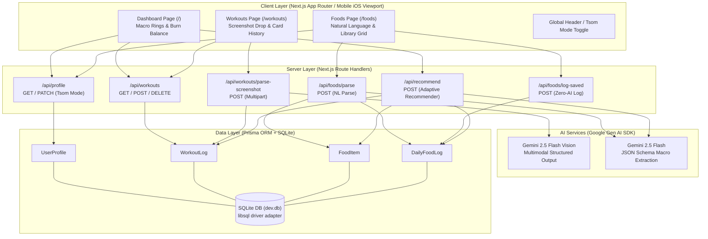
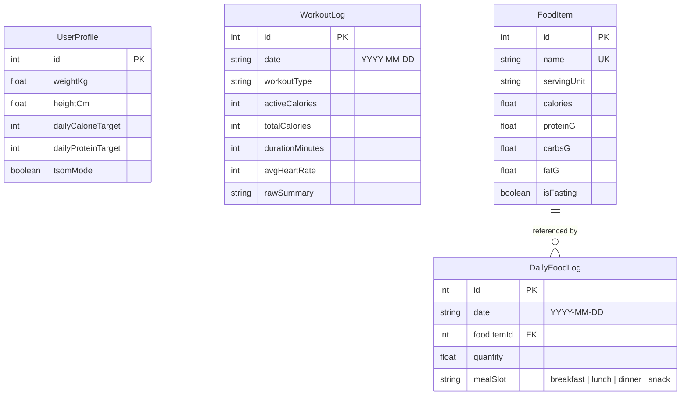
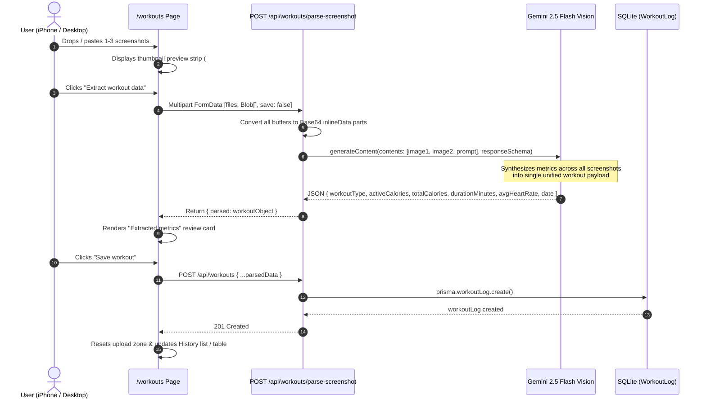
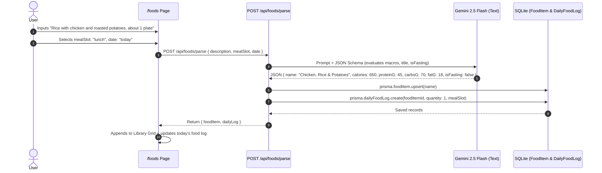
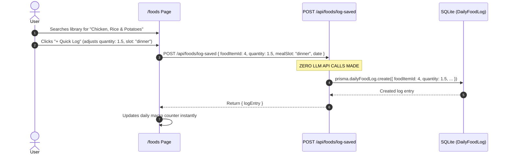
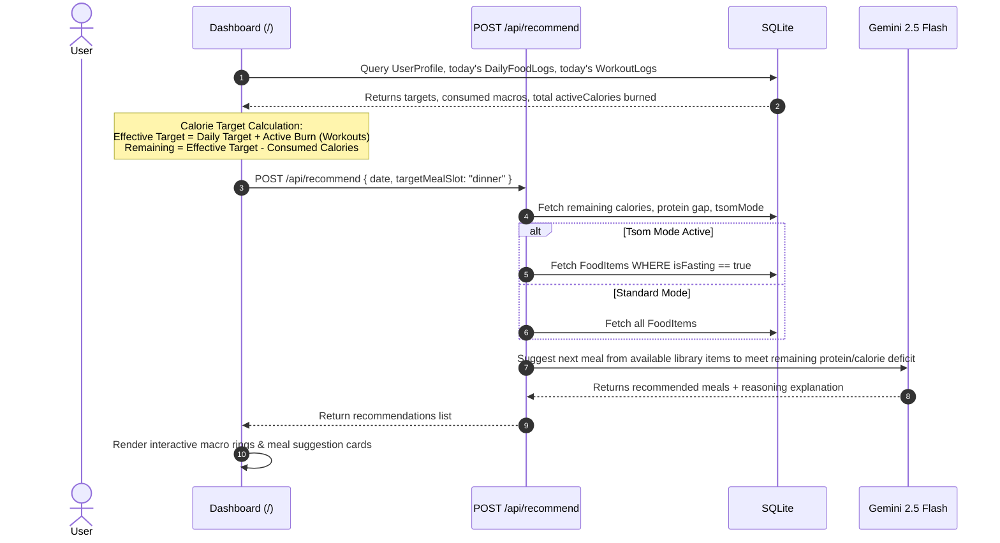

# MacroLog — System Design

## 1. System Overview & Core Constraints

MacroLog is an AI-powered fitness and nutrition platform built to eliminate manual tracking fatigue through two strict intake paradigms:

| Constraint | Principle | Implementation Rule |
|---|---|---|
| **Constraint 1: Workouts** | **100% Screenshot-Driven** | Never build manual workout forms. The only intake path is Gemini 2.5 Flash Vision extracting metrics from fitness app screenshots (single or multi-screenshot scrolled summaries). |
| **Constraint 2: Foods** | **Log Once, Reuse Forever** | First-time meals described in natural language are evaluated once by Gemini, titled, and saved to `FoodItem`. Repeat logs increment quantity against existing records with **zero LLM API calls**. |
| **Constraint 3: Tsom Mode** | **Orthodox Fasting Guard** | A global boolean toggle (`UserProfile.tsomMode`). When enabled, food library lists and AI meal recommendations strictly filter to `isFasting = true` (vegan/fasting-compliant). |

---

## 2. High-Level System Architecture



---

## 3. Data Model & Entity Relationships

The database is powered by SQLite via Prisma ORM 7 using the `@prisma/adapter-libsql` driver adapter.



### Model Definitions
- **`UserProfile`**: Singleton user configuration (`id: 1`). Holds target macros, height/weight defaults (`0`), and global `tsomMode` flag.
- **`WorkoutLog`**: Historical workout activities parsed strictly from screenshots. Tracks `activeCalories` (used to offset daily calorie burn).
- **`FoodItem`**: Master library of food items. Populated dynamically as user logs foods.
- **`DailyFoodLog`**: Relational join between date, meal slot (`breakfast`, `lunch`, `dinner`, `snack`), and `FoodItem` with quantity multiplier.

---

## 4. End-to-End Sequence Diagrams

### Flow 1: Workout Screenshot Intake (Multi-Image Support)
Handles 1 to 5 screenshots of a workout summary (e.g., scrolled Apple Fitness screens where top shows calories/time and bottom shows heart rate and splits).



---

### Flow 2: First-Time Food Logging (Single Natural-Language Parse)
Fulfills **Constraint 2**: natural-language intake evaluated once by Gemini and added to library.



---

### Flow 3: Repeat Food Log (Zero LLM Tokens)
Fulfills **Constraint 2**: re-logging an existing library item uses zero AI tokens.



---

### Flow 4: Dashboard & Adaptive Recommender (Offsetting Active Calories)



---

## 5. API Reference Specifications

### 5.1 Workout Intake API

#### `POST /api/workouts/parse-screenshot`
Parses one or more workout screenshot images with Gemini Vision.

- **Content-Type**: `multipart/form-data`
- **Query / Form Parameters**:
  - `files` / `file` (`Blob | Blob[]`, Required): 1 to 5 images (`PNG`, `JPG`, `WEBP`, `HEIC`).
  - `save` (`string`, Optional): `"false"` to return parsed preview; `"true"` (default) to persist directly into database.

**Sample Response (`save=false` Preview)**:
```json
{
  "parsed": {
    "date": "2026-11-22",
    "workoutType": "Outdoor Run",
    "activeCalories": 380,
    "totalCalories": 445,
    "durationMinutes": 34,
    "avgHeartRate": 152,
    "rawSummary": "Synthesized 34-min outdoor run with 380 active kcal burned from 2 screenshots."
  }
}
```

**Sample Response (`save=true` Persisted)**:
```json
{
  "workoutLog": {
    "id": 12,
    "date": "2026-11-22",
    "workoutType": "Outdoor Run",
    "activeCalories": 380,
    "totalCalories": 445,
    "durationMinutes": 34,
    "avgHeartRate": 152,
    "rawSummary": "Outdoor Run summary"
  }
}
```

---

#### `GET /api/workouts`
Retrieves all historical workout records.
- **Response**: `{ "workouts": WorkoutLog[] }` ordered by `date` desc, `id` desc.

---

#### `POST /api/workouts`
Persists a verified workout object into the database.
- **Content-Type**: `application/json`
- **Body**:
```json
{
  "date": "2026-11-22",
  "workoutType": "Traditional Strength Training",
  "activeCalories": 310,
  "totalCalories": 390,
  "durationMinutes": 45,
  "avgHeartRate": 134,
  "rawSummary": "Auditing text"
}
```
- **Response**: `201 Created` with `{ "workoutLog": WorkoutLog }`

---

#### `DELETE /api/workouts?id={id}`
Deletes an errant or test workout log by ID.
- **Response**: `{ "success": true, "deletedId": 12 }`

---

### 5.2 Food & Nutrition Intake API

#### `POST /api/foods/parse`
First-time natural language food entry. Parses nutritional values with Gemini, creates/updates `FoodItem`, and appends a `DailyFoodLog` entry.

- **Content-Type**: `application/json`
- **Body**:
```json
{
  "description": "2 eggs scrambled with half an avocado and slice of sourdough toast",
  "mealSlot": "breakfast",
  "date": "2026-11-22"
}
```
- **Response**:
```json
{
  "foodItem": {
    "id": 7,
    "name": "Scrambled Eggs with Avocado & Sourdough",
    "servingUnit": "plate",
    "calories": 420,
    "proteinG": 18.0,
    "carbsG": 28.0,
    "fatG": 24.0,
    "isFasting": false
  },
  "logEntry": {
    "id": 19,
    "date": "2026-11-22",
    "foodItemId": 7,
    "quantity": 1.0,
    "mealSlot": "breakfast"
  }
}
```

---

#### `POST /api/foods/log-saved`
Zero-AI repeat food logging route. Looks up an existing `FoodItem` ID and writes directly to `DailyFoodLog`.

- **Content-Type**: `application/json`
- **Body**:
```json
{
  "foodItemId": 7,
  "quantity": 1.5,
  "mealSlot": "breakfast",
  "date": "2026-11-22"
}
```
- **Response**: `201 Created` with `{ "logEntry": DailyFoodLog }`

---

#### `GET /api/foods`
Returns all library food items, with optional Tsom filtering.
- **Query Params**:
  - `tsomOnly` (`boolean`, Optional): If `true`, returns only `isFasting == true` items.
  - `search` (`string`, Optional): Filters by food item name.
- **Response**: `{ "foods": FoodItem[] }`

---

### 5.3 Recommendation & Profile API

#### `POST /api/recommend`
Generates adaptive next-meal recommendations factoring in active calories burned from workouts and Tsom Mode compliance.

- **Content-Type**: `application/json`
- **Body**:
```json
{
  "date": "2026-11-22",
  "mealSlot": "dinner"
}
```
- **Response**:
```json
{
  "recommendations": [
    {
      "foodItemId": 2,
      "name": "Lentil Soup with Sourdough",
      "portionSuggestion": "1.5 bowls",
      "calories": 480,
      "proteinG": 28.0,
      "isFasting": true
    }
  ],
  "reasoning": "You burned 380 active kcal running today and have 42g of protein left to reach your target. Since Tsom Mode is active, this lentil bowl meets your protein goal while complying with fasting."
}
```

---

#### `PATCH /api/profile`
Toggles global settings such as Tsom Mode or adjusts targets.
- **Body**: `{ "tsomMode": true, "dailyCalorieTarget": 2400 }`
- **Response**: `{ "profile": UserProfile }`

---

## 6. Page-by-Page Feature & Data Matrix

| Page Route | User Actions | API Endpoints Called | Data Read / Written |
|---|---|---|---|
| **`/` (Dashboard)** | View calorie balance ring, protein/carb/fat bars, workout burn offset, request next-meal suggestions. | `GET /api/workouts`<br/>`GET /api/profile`<br/>`POST /api/recommend` | Reads: `UserProfile`, `WorkoutLog`, `DailyFoodLog`, `FoodItem` |
| **`/workouts`** | Upload 1-5 screenshots, view preview thumbnails, trigger extraction, review parsed card, save to log, delete workout. | `POST /api/workouts/parse-screenshot`<br/>`POST /api/workouts`<br/>`DELETE /api/workouts` | Writes: `WorkoutLog`<br/>Reads: `WorkoutLog` history |
| **`/foods`** | Input natural language meal, view AI parsed macros, search library, one-tap re-log saved foods, toggle Tsom Mode. | `POST /api/foods/parse`<br/>`POST /api/foods/log-saved`<br/>`GET /api/foods`<br/>`PATCH /api/profile` | Writes: `FoodItem`, `DailyFoodLog`<br/>Reads: `FoodItem`, `UserProfile` |

---

## 7. Token Optimization Strategy

- **Workouts**: 1 LLM call per upload session (even when multiple screenshots are uploaded, they are merged into one prompt).
- **Food logging**: Exactly 1 LLM call when a meal is novel. All subsequent logs of that food cost **0 LLM tokens**.
- **Recommendations**: Only invoked on explicit user request; prompts are seeded with pre-calculated macro balance deltas.
