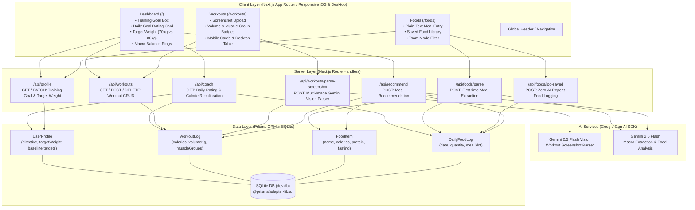
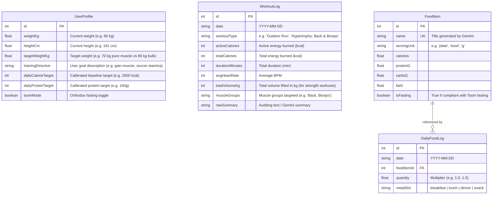
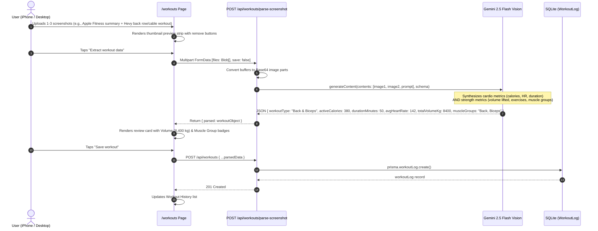
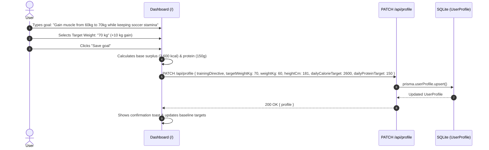
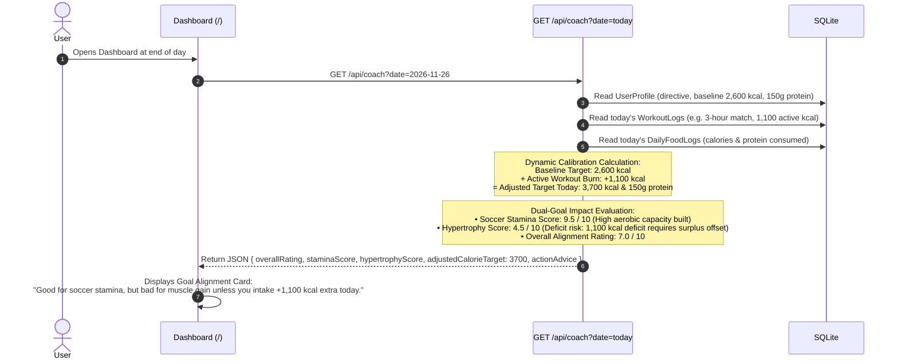
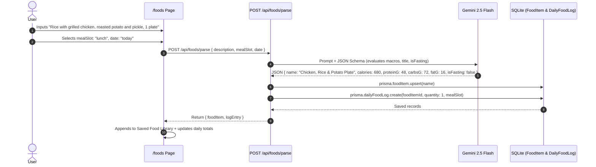
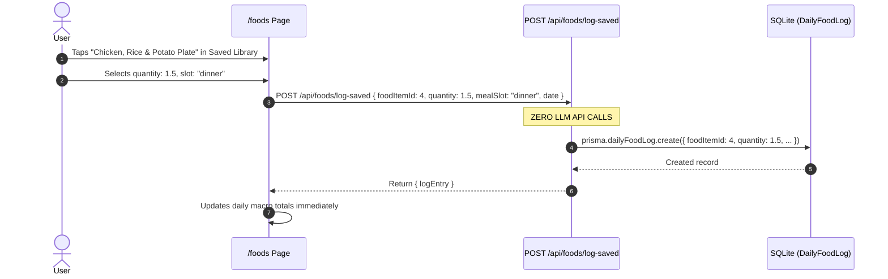

# MacroLog — System Design

## 1. System Overview & Core Pillars

MacroLog is a workout and macro tracking app that parses fitness screenshots and adjusts your daily calorie and protein goals based on what you are training for.

| Pillar / Constraint | Principle | Implementation Rule |
|---|---|---|
| **Constraint 1: Workouts** | **100% Screenshot-Driven** | Never build manual workout forms. The only way to log workouts is uploading screenshots from fitness apps (Apple Fitness, Garmin, Strava, Hevy, Strong). Gemini extracts the numbers (calories, duration, heart rate, volume lifted, and muscle groups). |
| **Constraint 2: Foods** | **Log Once, Reuse Forever** | The first time you eat something, describe it in plain words. Gemini estimates the calories and macros once and saves it to your library. When you log that food again, you pick it from the library with zero AI calls. |
| **Constraint 3: Tsom Mode** | **Orthodox Fasting Toggle** | A global toggle (`UserProfile.tsomMode`). When on, the food library and recommendations only show fasting-compliant foods (`isFasting = true`). |
| **Pillar 4: Training Goal & Daily Adjustment** | **Goal-Based Target Recalibration** | You write what you are training for in a text box (e.g. *"gain muscle from 60kg to 70kg at 181cm while keeping stamina for soccer"*). If you burn calories working out, the app adds those calories to your daily target so you do not lose weight by accident, and gives you a rating for the day. |

---

## 2. High-Level System Architecture



---

## 3. Data Model & Entity Relationships

The schema is persisted in SQLite via Prisma ORM with the LibSQL driver adapter.



---

## 4. End-to-End Sequence Diagrams

### Flow 1: Workout Screenshot Intake (Cardio & Resistance/Strength Workouts)
Handles single or multiple screenshots (1–5 images) across sports and lifting apps (Apple Fitness, Garmin, Strava, Hevy, Strong). Gemini Vision extracts volume and exercises without manual form filling.



---

### Flow 2: Training Goal Setup & Target Weight
Sets your training goal and target weight (e.g. 60 kg &rarr; 70 kg at 181 cm).



---

### Flow 3: Daily Goal Calibration & Alignment Rating (Balancing Competing Goals)
Addresses the trade-off: **High-volume cardio/sports (e.g. 3-hour soccer/tennis) vs. Muscle hypertrophy**. Automatically scales daily targets so calories burned in cardio do not burn off muscle mass.



---

### Flow 4: First-Time Food Logging (Natural Language Parse & Save)



---

### Flow 5: Repeat Food Log (Zero AI Tokens)



---

## 5. API Reference Specifications

### 5.1 Goal & Daily Rating API

#### `GET /api/coach`
Checks the day's workouts and food intake against your goal.

- **Query Parameters**:
  - `date` (`string`, Optional): Date formatted as `YYYY-MM-DD`. Defaults to today.
- **Response (`200 OK`)**:
```json
{
  "date": "2026-11-26",
  "profile": {
    "currentWeightKg": 60,
    "targetWeightKg": 70,
    "heightCm": 181,
    "trainingDirective": "Gain muscle from 60kg to 70kg at 181cm while keeping soccer stamina."
  },
  "intake": {
    "consumedCalories": 1850,
    "consumedProtein": 110,
    "activeBurn": 1100,
    "totalWorkoutMinutes": 180
  },
  "targets": {
    "baselineCalories": 2600,
    "baselineProtein": 150,
    "adjustedCalorieTarget": 3700,
    "remainingCalories": 1850,
    "remainingProtein": 40
  },
  "evaluation": {
    "overallRating": 7.0,
    "staminaScore": 9.5,
    "hypertrophyScore": 4.5,
    "assessmentSummary": "Big cardio day (1,100 kcal burn over 3 hours). Great for soccer stamina, but you need more food to keep from losing weight.",
    "actionAdvice": "Eat an extra 1,850 kcal and 40g protein before bed to make up for your 3-hour match."
  }
}
```

---

#### `GET /api/profile` & `PATCH /api/profile`
Reads or updates the user's training goals and biometrics.

- **`PATCH` Request Body**:
```json
{
  "trainingDirective": "Gain lean muscle mass from 60kg to 70kg at 181cm while building stamina for soccer",
  "weightKg": 60,
  "heightCm": 181,
  "targetWeightKg": 70,
  "dailyCalorieTarget": 2600,
  "dailyProteinTarget": 150,
  "tsomMode": false
}
```
- **Response (`200 OK`)**: `{ "profile": UserProfile }`

---

### 5.2 Workout Intake API

#### `POST /api/workouts/parse-screenshot`
Parses 1 to 5 fitness screenshots (Apple Fitness, Garmin, Strava, Hevy, Strong).

- **Content-Type**: `multipart/form-data`
- **Form Data**:
  - `files` / `file` (`File[]`, Required): 1–5 image files.
  - `save` (`string`, Optional): `"false"` to return preview; `"true"` to save directly.
- **Sample Response**:
```json
{
  "parsed": {
    "date": "2026-11-26",
    "workoutType": "Hypertrophy: Back & Biceps",
    "activeCalories": 380,
    "totalCalories": 460,
    "durationMinutes": 52,
    "avgHeartRate": 138,
    "totalVolumeKg": 8450,
    "muscleGroups": "Back, Biceps",
    "rawSummary": "Upper body pull session: 4 exercises including cable rows and lat pulldowns; 8,450 kg total volume."
  }
}
```

---

#### `GET /api/workouts`, `POST /api/workouts`, `DELETE /api/workouts`
Full CRUD management for saved workout records.
- `GET /api/workouts` &rarr; `{ "workouts": WorkoutLog[] }`
- `POST /api/workouts` &rarr; Creates verified `WorkoutLog`
- `DELETE /api/workouts?id={id}` &rarr; Removes workout log

---

### 5.3 Food & Nutrition API

#### `POST /api/foods/parse`
Evaluates natural language meal description once with Gemini, upserts `FoodItem`, and logs entry.
- **Body**: `{ "description": "1 plate rice with chicken, roasted potatoes and pickle", "mealSlot": "lunch", "date": "2026-11-26" }`
- **Response**: `{ "foodItem": FoodItem, "logEntry": DailyFoodLog }`

#### `POST /api/foods/log-saved`
Zero-AI repeat food logging route.
- **Body**: `{ "foodItemId": 4, "quantity": 1.5, "mealSlot": "dinner", "date": "2026-11-26" }`
- **Response**: `{ "logEntry": DailyFoodLog }`

#### `GET /api/foods`
Retrieves library items with optional `tsomOnly=true` filtering.

---

## 6. Dashboard Interface Architecture

```
+-----------------------------------------------------------------------------------+
| MacroLog                 Dashboard    Workouts    Foods                           |
+-----------------------------------------------------------------------------------+
| TRAINING GOAL & TARGET WEIGHT                                                     |
| Goal:   [ Gain muscle from 60kg to 70kg at 181cm while keeping soccer stamina... ] |
| Current: 60 kg (181 cm)   |   [x] 70 kg (+10kg gain)   |   [ ] 80 kg Bulk           |
|                                                                     [ Save goal ]  |
+-----------------------------------------------------------------------------------+
| TODAY'S RATING & GOAL ALIGNMENT                                    Score: 7.5 / 10 |
| +-----------------------------------------+-------------------------------------+ |
| | Soccer Stamina: 9.5 / 10                | Muscle Gain: 4.5 / 10               | |
| | 3 hr tennis/soccer match (1,100 kcal)   | High calorie deficit                | |
| +-----------------------------------------+-------------------------------------+ |
| TODAY'S CALORIE TARGET:                                                           |
| Base: 2,600 kcal + Workout Burn: +1,100 kcal = TARGET TODAY: 3,700 kcal           |
| Advice: "Good for soccer, but you need +1,100 extra calories today to keep from   |
|         losing weight."                                                           |
+-----------------------------------------------------------------------------------+
| Workouts Logged: 12      | Active Energy Burned: 4,850 kcal | Food Library: 18    |
+-----------------------------------------------------------------------------------+
| RECENT WORKOUTS                                                                   |
| • Hypertrophy: Back & Biceps   • 2026-11-26 • 8,450 kg volume • 380 kcal • 52 min |
| • Tennis / Soccer Match        • 2026-11-25 • 1,100 active kcal • 180 min         |
+-----------------------------------------------------------------------------------+
```

---

## 7. Token Optimization Strategy

- **Workouts**: Exactly 1 LLM Vision call per intake session, even when 3 screenshots (e.g. cardio top screen + resistance exercises bottom screen) are uploaded.
- **Foods**: Exactly 1 LLM call when a food is novel. All subsequent logs use **zero LLM tokens**.
- **Coaching & Daily Rating**: Deterministic formula for macro scaling and goal trade-off calculations runs locally on the server without consuming external LLM tokens for standard metric evaluation.
